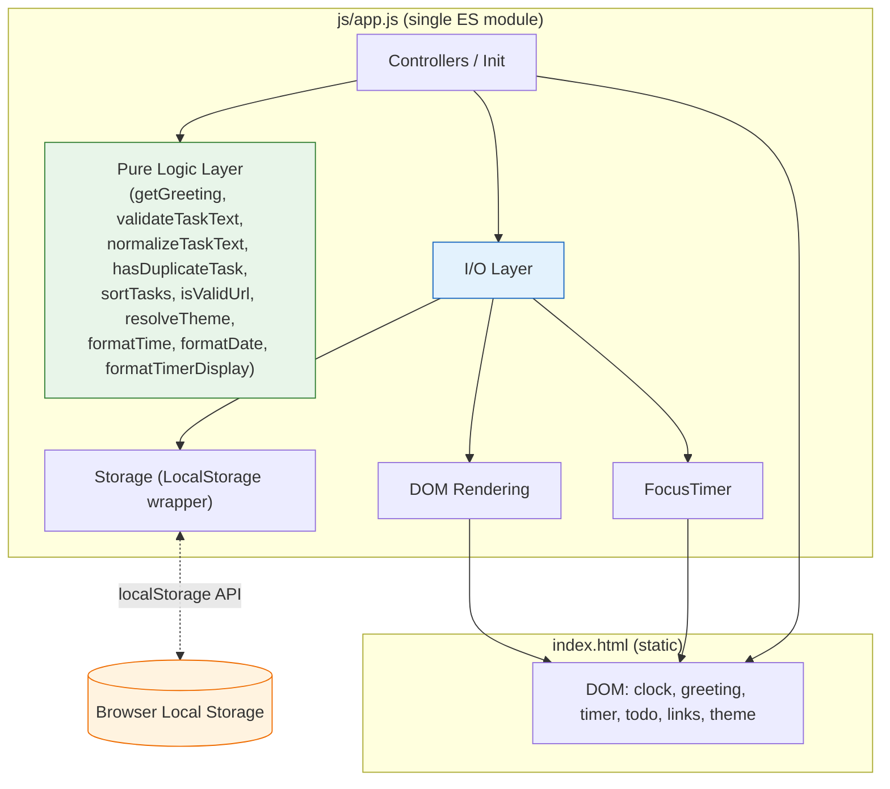
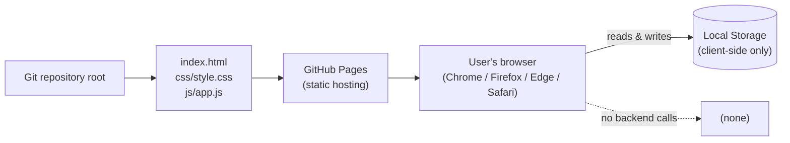
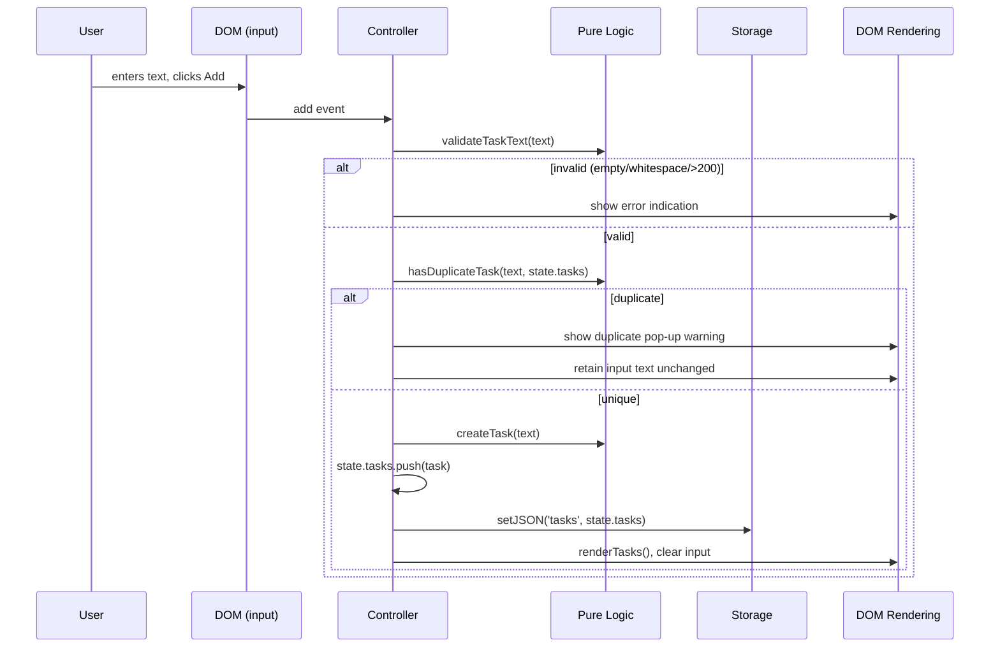

# Design Document

## Overview

The Todo List Life Dashboard is a single-page, client-only web application that consolidates a live clock with a contextual greeting, a 25-minute focus timer, a persistent to-do list, and quick links to favorite websites into one minimal page. It runs entirely in the browser with no backend, persisting all user data through the browser Local Storage API, and is deployed as a static site through GitHub Pages.

This document defines the architecture and implementation approach for a build using only HTML, CSS, and Vanilla JavaScript (no frameworks or runtime libraries). It satisfies the 11 requirements captured in `requirements.md`, covering time/greeting display, the focus timer, todo CRUD, quick links, task sorting, duplicate-task prevention, the light/dark theme toggle, standalone browser operation, client-side persistence, performance, and visual/code-structure constraints.

### Design Goals

- **Zero runtime dependencies.** The production site ships exactly one HTML file, one CSS file (`css/style.css`), and one JavaScript file (`js/app.js`) per Requirements 11.1 and 11.2, with no framework, no build step, and no backend calls (Req 8.2, 8.3).
- **Separation of pure logic from I/O.** The core business logic (greeting computation, text validation, duplicate detection, sorting, URL validation, theme resolution, formatting) is implemented as pure functions with no DOM or storage access. This makes the core logic independently testable with property-based testing and keeps the I/O layer (DOM rendering, LocalStorage, timer) thin and substitutable.
- **Resilient persistence.** The storage layer feature-detects LocalStorage availability and wraps every write in error handling, because browsers such as Safari in private mode throw `QuotaExceededError` on `setItem` even when storage appears to exist. On failure the app retains the session's data in memory and surfaces an error indication (Req 9.4).
- **Minimal, themeable, accessible UI.** A single CSS file drives both light and dark themes via CSS custom properties (variables), with a base font size of at least 16px, larger section headings, and visible section spacing (Req 11.3–11.5).
- **Testability without violating the single-file production constraint.** The pure logic functions are exported from `js/app.js` so the test suite can import them; the test runner and property-based testing library are dev dependencies only and are not part of the deployed static site.

### Research Findings

Two areas were researched to inform this design:

1. **LocalStorage failure modes.** LocalStorage can be unavailable or throw on write in several cases: Safari private browsing sets a zero quota and throws `QuOTA_EXCEEDED_ERR` / `QuotaExceededError` on `setItem`; the per-origin quota (commonly ~5 MB) can be exceeded; and `localStorage` can be disabled by the user. The reliable pattern is to feature-detect availability by attempting a `setItem`/`removeItem` probe inside a `try/catch`, and to wrap every production write in `try/catch`, distinguishing "unavailable" from "quota exceeded" only to the extent needed to show an error indication and keep the in-memory state. Sources: [TrackJS — setItem failures](https://trackjs.com/javascript-errors/failed-to-execute-setitem-on-storage/), [Stack Overflow — Safari QUOTA_EXCEEDED_ERR](https://stackoverflow.com/questions/14555347/html5-localstorage-error-with-safari-quota-exceeded-err-dom-exception-22-an).
2. **Property-based testing for Vanilla JS / ESM.** `fast-check` is the standard property-based testing library for JavaScript/TypeScript and integrates cleanly with Vitest, a modern test runner with native ESM support. Vitest can import the exported pure functions directly from `js/app.js` without a bundler, which fits the no-build-step constraint for the production app while still allowing a test suite. Sources: [fast-check on GitHub](https://github.com/dubzzz/fast-check), [Vitest configuration docs](https://vitest.dev/config/).

## Architecture

The application is a single static page whose behavior lives in one ES module (`js/app.js`). Internally the module is organized into three layers so that the business logic has no dependencies on the browser environment and can be tested in isolation.

### Layered Structure

1. **Pure Logic Layer.** Stateless, side-effect-free functions that take inputs and return outputs. They never touch `document`, `window`, `localStorage`, or timers. These are the functions exported for property-based and unit testing.
2. **I/O Layer.** The thin adapters that the pure logic cannot contain:
   - **Storage** — a LocalStorage wrapper with availability detection and quota-safe writes.
   - **DOM rendering** — functions that read state and produce/update DOM nodes.
   - **FocusTimer** — the interval-based countdown that depends on `Date.now()` and `setInterval`.
3. **Controller / Initialization Layer.** Wires user events to state transitions, calls the pure logic to compute the next state, persists via Storage, and re-renders. It also runs the startup sequence (restore state, render, start the clock).

This layering is a code-organization decision inside one file, not a multi-file split, so it satisfies the single-JS-file requirement (Req 11.2) while keeping the core logic testable.

### Component Diagram



The green Pure Logic Layer has no arrows to the browser environment; only the blue I/O Layer and Controllers touch the DOM and LocalStorage.

### Deployment Architecture

The site is a set of static files served as-is. There is no server runtime.



### Module Import and Side-Effect Safety

Because the pure functions are exported from the same file that boots the app, importing `js/app.js` in a test must not trigger DOM access that would fail outside the dashboard page. The module guards initialization behind the presence of the root element:

```js
// js/app.js — bottom of file
if (typeof document !== 'undefined') {
  if (document.readyState === 'loading') {
    document.addEventListener('DOMContentLoaded', init);
  } else {
    init();
  }
}

function init() {
  const root = document.getElementById('dashboard');
  if (!root) return; // not the dashboard page (e.g., test import) — no side effects
  // ...restore, render, start clock
}
```

When a test imports the module in a jsdom environment without the `#dashboard` element, `init` returns immediately and the exported pure functions remain available. This keeps the production single-file constraint intact while making the core logic importable for testing.

## Components and Interfaces

The following pure functions are the testable core. All are exported from `js/app.js`. Types are expressed in JSDoc-style notation for readability; the project uses plain JavaScript, not TypeScript.

### Pure Logic (exported)

| Function | Signature | Description | Requirement |
|---|---|---|---|
| `getGreeting` | `(hour: number) => string` | Maps an hour `0–23` to `'Good Morning'` (05–11), `'Good Afternoon'` (12–16), `'Good Evening'` (17–20), or `'Good Night'` (21–04). | 1.3–1.6 |
| `formatTime` | `(date: Date) => string` | Returns a locale-aware local time string (e.g., `09:42`). | 1.1 |
| `formatDate` | `(date: Date) => string` | Returns a locale-aware date string containing day, month, and year. | 1.2 |
| `validateTaskText` | `(text: string) => { valid: boolean; error?: string }` | Valid iff trimmed length is `1–200`; rejects empty/whitespace-only and over-length input. | 3.1, 3.7 |
| `normalizeTaskText` | `(text: string) => string` | Returns `text.trim().toLowerCase()` for case-insensitive duplicate comparison. | 6.1 |
| `hasDuplicateTask` | `(text: string, tasks: Task[]) => boolean` | True iff some existing task's normalized text equals the normalized input. | 6.1, 6.2 |
| `sortTasks` | `(tasks: Task[], sortBy: 'name'\|'date'\|'status') => Task[]` | Returns a new array sorted by the chosen key; does not mutate the input. | 5.2–5.4 |
| `createTask` | `(text: string) => Task` | Returns `{ id, text, createdAt, done: false }` with `id = crypto.randomUUID()`. | 3.1 |
| `deleteTask` | `(tasks: Task[], id: string) => Task[]` | Returns a new array without the task whose `id` matches. | 3.4 |
| `isValidUrl` | `(url: string) => boolean` | True iff the URL parses via `new URL()` and uses an accepted scheme (`http`, `https`, or a known custom scheme). | 4.5 |
| `resolveTheme` | `(stored: string\|null\|undefined) => 'light'\|'dark'` | Returns `'light'` or `'dark'` when stored, else `'light'` (default). | 7.4, 7.5 |
| `addLink` | `(links: Link[], newLink: Link) => Link[]` | Returns a new link list with `newLink` appended, capped at 12 entries (excess additions are rejected). | 4.1 |
| `formatTimerDisplay` | `(remainingMs: number) => string` | Formats milliseconds as `MM:SS`, clamping negatives to `00:00`. | 2.1, 2.4 |

### I/O Layer (not exported; internal to the module)

**Storage wrapper** — `Storage` object:
- `Storage.isAvailable(): boolean` — probes LocalStorage with a `try/catch` setItem/removeItem; cached after first check.
- `Storage.getJSON<T>(key: string, fallback: T): T` — reads and `JSON.parse`s a key; returns `fallback` on missing/corrupt data or when unavailable.
- `Storage.setJSON(key: string, value: unknown): { ok: boolean; error?: string }` — `JSON.stringify`s and writes; returns `{ ok: false }` and keeps in-memory state on quota/unavailable errors.

**DOM rendering** — `renderTime()`, `renderGreeting()`, `renderTasks()`, `renderLinks()`, `renderTheme()`, `renderTimer()`. Each reads from an in-memory `state` object and updates only the DOM nodes it owns, to keep interaction updates within the 200 ms target (Req 10.2).

**FocusTimer** — `Timer.start()`, `Timer.stop()`, `Timer.reset()`. Uses a timestamp-based countdown (`endTime = Date.now() + remainingMs`) rather than decrementing a counter on each tick, so it remains accurate when the tab is backgrounded and interval throttling occurs.

**Notification** — a toast component used for transient messages (duplicate warning, URL error, validation error, persistence failure) instead of blocking native dialogs, satisfying the "pop-up warning" requirement (Req 6.1) with a non-intrusive, auto-dismissing popup.

### Controller / Event Wiring

Controllers translate DOM events into state transitions. The add-task flow is illustrative of the pattern shared by all mutations:



## Data Models

All persistent data is JSON-serialized into LocalStorage under a single namespaced key per entity. In-memory state mirrors the stored structures.

### Task

```js
// stored under key "todoDashboard.tasks" as a JSON array
{
  id: string,         // unique id, crypto.randomUUID()
  text: string,       // entered text, validated to 1–200 non-whitespace-only chars
  createdAt: number,  // creation time in epoch milliseconds (Date.now())
  done: boolean       // completion status; false when created
}
```

Design decision on stored text: the task `text` is stored exactly as the user entered it once it passes validation, while duplicate detection compares the trimmed, lower-cased (normalized) forms (Req 6.1). This keeps the user's entered text intact while still treating `"Buy Milk"` and `"  buy milk  "` as duplicates. When a duplicate is rejected, the input field's text is left unmodified (Req 6.2).

### QuickLink

```js
// stored under key "todoDashboard.links" as a JSON array
{
  id: string,   // unique id
  name: string, // button label
  url: string   // website URL opened in a new tab
}
```

The list is capped at 12 entries (Req 4.1). Although the requirements specify the persistence behavior for added/removed/modified links (Req 4.3) without detailing the management UI, the design provides a minimal link management form (name + URL add fields, per-link delete, and inline edit) to satisfy the implied add/remove/modify capability.

### Theme

```js
// stored under key "todoDashboard.theme" as a JSON string
'light' | 'dark'
```

If the stored value is absent, `null`, `undefined`, or not one of the two valid values, `resolveTheme` returns `'light'` (Req 7.5). The active theme is applied by setting a `data-theme` attribute on the root `<html>` element, which CSS custom properties key off of.

### Timer State (in-memory only; not persisted)

```js
{
  durationMs: number,    // constant 1_500_000 (25 minutes)
  remainingMs: number,   // current remaining time, starts at durationMs
  running: boolean,      // whether the countdown is active
  endTime: number | null // timestamp the countdown will reach zero; null when stopped
}
```

The timer is intentionally not persisted. On every page load it resets to 25:00 (Req 2.4), since a focus session is session-scoped and resuming a backgrounded timer across reloads is out of scope.

### LocalStorage Key Schema

| Key | Type | Requirement |
|---|---|---|
| `todoDashboard.tasks` | `Task[]` | 3.5, 3.6, 9.1 |
| `todoDashboard.links` | `Link[]` | 4.3, 4.4 |
| `todoDashboard.theme` | `'light'` \| `'dark'` | 7.3, 7.4 |

All keys share a `todoDashboard.` namespace to avoid collisions with other apps on the same origin.

## Correctness Properties

*A property is a characteristic or behavior that should hold true across all valid executions of a system—essentially, a formal statement about what the system should do. Properties serve as the bridge between human-readable specifications and machine-verifiable correctness guarantees.*

The architecture separates a pure-logic layer (greeting, validation, duplicate detection, sorting, URL validation, theme resolution, formatting, and list operations) from the I/O layer (DOM and LocalStorage), which makes property-based testing suitable for this feature. The properties below target the pure functions; the DOM, timer, and persistence behaviors are covered by integration tests in the Testing Strategy.

After prework analysis, redundant properties were consolidated: the four greeting criteria collapse into one partition/mapping property; the three sort keys collapse into one parameterized property; and the storage round-trip referenced by six persistence criteria collapses into one property covering all three storage keys.

### Property 1: Greeting correctness and full partition

*For any* hour `h` in `0..23`, `getGreeting(h)` returns exactly the greeting defined by `h`'s range — `'Good Morning'` for 05–11, `'Good Afternoon'` for 12–16, `'Good Evening'` for 17–20, and `'Good Night'` for 21–04 — and the four ranges partition all 24 hours with no overlap and no gap.

**Validates: Requirements 1.3, 1.4, 1.5, 1.6**

### Property 2: Date and time formatting contain required components

*For any* `Date`, `formatTime(date)` produces a string reflecting the local hour and minute, and `formatDate(date)` produces a string containing the localized day, month, and year components derived from `date`.

**Validates: Requirements 1.1, 1.2**

### Property 3: Timer display round-trip and reset-to-duration

*For any* non-negative `remainingMs` up to the 25-minute duration, `parseTimerDisplay(formatTimerDisplay(remainingMs))` equals `remainingMs`, and for negative input the display is clamped to `00:00`; and *for any* prior timer state, reset sets `remainingMs` to the 25-minute duration (`1_500_000` ms).

**Validates: Requirements 2.1, 2.4**

### Property 4: Valid task text is accepted and yields a well-formed task; invalid text is rejected

*For any* string `s`, `validateTaskText(s)` accepts it if and only if `s.trim().length` is between 1 and 200 (rejecting empty, all-whitespace, and over-length input), and *for any* valid text, `createTask(s)` returns a task with `done === false`, a non-empty unique `id`, and `text === s`.

**Validates: Requirements 3.1, 3.7**

### Property 5: Duplicate detection matches on trimmed, case-insensitive text and normalization is idempotent

*For any* string `t`, `normalizeTaskText` is idempotent: `normalizeTaskText(normalizeTaskText(t)) === normalizeTaskText(t)`; and *for any* text `t` and task list `tasks`, `hasDuplicateTask(t, tasks)` is true if and only if some existing task's normalized text equals `normalizeTaskText(t)` — including cases differing only in leading/trailing whitespace or letter case.

**Validates: Requirements 6.1, 6.2**

### Property 6: Sorting preserves elements and orders by the selected key

*For any* task list and *for any* sort key in `{ 'name', 'date', 'status' }`, `sortTasks(tasks, key)` returns an array that is a permutation of the input (identical multiset of `id`s, with no loss or duplication) and is ordered by the key: `name` by case-insensitive ascending text, `date` by ascending `createdAt`, and `status` by ascending status name with a defined, deterministic tie-break.

**Validates: Requirements 5.2, 5.3, 5.4**

### Property 7: URL validation accepts parseable accepted-scheme URLs and rejects the rest

*For any* string `u`, `isValidUrl(u)` returns true if and only if `u` parses via `new URL(u)` (with a reasonable base) and uses an accepted scheme (`http` or `https`, plus recognized custom schemes such as `mailto`); otherwise it returns false.

**Validates: Requirements 4.5**

### Property 8: Theme resolution defaults to light and round-trips known values

*For any* stored value, `resolveTheme(stored)` returns `'light'` when the value is `null`, `undefined`, empty, or any value other than `'light'` or `'dark'`; and returns `'light'` or `'dark'` unchanged when the value is one of those two.

**Validates: Requirements 7.4, 7.5**

### Property 9: Quick-link list never exceeds 12 entries

*For any* link list of length at most 12 and *for any* new link, `addLink(links, newLink)` yields a list whose length never exceeds 12; when the list already has 12 entries the new link is rejected and the list is unchanged.

**Validates: Requirements 4.1**

### Property 10: Deleting a task removes exactly the target and preserves the rest

*For any* task list and *for any* id, `deleteTask(tasks, id)` removes exactly the task with that id (reducing length by 1 if present, by 0 if absent) and leaves every other task's `id`, `text`, `createdAt`, and `done` unchanged.

**Validates: Requirements 3.4**

### Property 11: Storage round-trip preserves all persisted data

*For any* `Task[]`, `Link[]`, and theme value, storing each under its namespaced key via `Storage.setJSON` and reading it back via `Storage.getJSON` returns an equal value (deep-equal for the arrays, equal for the theme string); and `getJSON` returns its fallback when the key is missing, corrupt, or storage is unavailable.

**Validates: Requirements 3.5, 3.6, 4.3, 4.4, 7.3, 9.1, 9.3**

## Error Handling

The design distinguishes three categories of errors and handles each deliberately.

### Persistence Errors (Req 9.4)

LocalStorage can be unavailable (Safari private mode, disabled storage) or over quota. The Storage wrapper handles both:

- **Availability detection.** On first use, `Storage.isAvailable()` runs a `try { localStorage.setItem('__probe__', '1'); localStorage.removeItem('__probe__'); } catch { return false; }` and caches the result. When unavailable, all reads return their fallback and all writes are no-ops that return `{ ok: false }`.
- **Quota-safe writes.** Every `setJSON` call wraps `localStorage.setItem` in `try/catch`. On a thrown `QuotaExceededError` (or any error), it returns `{ ok: false, error }` and leaves the in-memory `state` intact.
- **User indication + session retention.** Controllers check the `{ ok }` result; on failure they surface a toast error indication and continue operating against the in-memory `state` for the rest of the session, so the user keeps their data until the tab closes. Corrupt data on read (invalid JSON) is treated as "missing" and the fallback is used, never crashing the page.

### Input Validation Errors (Req 3.7, 6.1)

- **Invalid task text** (empty, whitespace-only, or over 200 chars) is rejected by `validateTaskText`. The controller shows an inline error indication near the input and does not modify the task list or clear the input.
- **Duplicate task** is detected by `hasDuplicateTask` using normalized (trimmed, lower-cased) text. The controller shows a pop-up warning (toast) indicating a duplicate already exists and that the task was not added, and leaves the input text unmodified (Req 6.2). Duplicates never enter the list or storage.
- **Invalid quick-link URL** is rejected by `isValidUrl`. The controller shows an error message indicating the URL is invalid and does not call `window.open` (Req 4.5). Adding a 13th link is rejected by `addLink` with an indication that the 12-link maximum is reached (Req 4.1).

### Operational Errors (Req 2.5, 8.x)

- **Timer completion.** When the timestamp-based countdown reaches zero, the timer stops and triggers a visual indication (the timer state highlights) plus an audio notification via the Web Audio API (a short beep), with the audio call guarded so a failure to play does not break the page.
- **Browser/standalone degradation.** Only broadly supported APIs are used (`Intl.DateTimeFormat`, `localStorage`, `URL`, `setInterval`). `crypto.randomUUID` is used for ids with a `Math.random`-based fallback for older browsers, so id generation never throws. No network calls exist, so there are no network-failure paths (Req 8.2).

All user-facing errors use the non-blocking toast component, keeping the interface calm and the workflow uninterrupted.

## Testing Strategy

The feature uses a dual testing approach: property-based tests for the universal properties of the pure-logic layer, and example/integration tests for the I/O layer, the UI, and the performance SLAs. The test stack is Vitest (native ESM, no bundler needed) with `fast-check` for property-based testing and `jsdom` (or `happy-dom`) for DOM integration tests. A localStorage mock simulates availability and quota errors.

The test infrastructure is dev-only: `package.json`, `vitest.config.js`, and `test/**/*.test.js` are not deployed to GitHub Pages and do not violate the single-JS-file production constraint (Req 11.2), which applies to the deployed `js/app.js`.

### Property-Based Tests (pure logic)

Each property below is implemented as a single property-based test with a minimum of 100 iterations, importing the exported function from `../js/app.js`. Each test is tagged with a comment referencing the design property.

- `getGreeting` partition + mapping — generators for `hour` over `0..23`. Tag: **Feature: todo-list-life-dashboard, Property 1: Greeting correctness and full partition**. Validates Req 1.3–1.6.
- `formatTime` / `formatDate` component containment — generator for arbitrary `Date`. Tag: **Feature: todo-list-life-dashboard, Property 2: Date and time formatting contain required components**. Validates Req 1.1, 1.2.
- `formatTimerDisplay` round-trip + clamp, and reset-to-duration — generators for `remainingMs` (including negatives). Tag: **Feature: todo-list-life-dashboard, Property 3: Timer display round-trip and reset-to-duration**. Validates Req 2.1, 2.4.
- `validateTaskText` / `createTask` accept-reject + shape — generators for arbitrary strings (including whitespace-only and long strings). Tag: **Feature: todo-list-life-dashboard, Property 4: Valid task text is accepted and yields a well-formed task; invalid text is rejected**. Validates Req 3.1, 3.7.
- `normalizeTaskText` idempotence + `hasDuplicateTask` matching — generators for strings and task lists with whitespace/case variation. Tag: **Feature: todo-list-life-dashboard, Property 5: Duplicate detection matches on trimmed, case-insensitive text and normalization is idempotent**. Validates Req 6.1, 6.2.
- `sortTasks` permutation + ordering per key — generators for task lists and keys; assert same `id` multiset and correct order with deterministic tie-break. Tag: **Feature: todo-list-life-dashboard, Property 6: Sorting preserves elements and orders by the selected key**. Validates Req 5.2–5.4.
- `isValidUrl` accept/reject — generators for malformed, empty, and valid URLs across schemes. Tag: **Feature: todo-list-life-dashboard, Property 7: URL validation accepts parseable accepted-scheme URLs and rejects the rest**. Validates Req 4.5.
- `resolveTheme` default + identity — generators including `null`, `undefined`, `''`, and arbitrary strings. Tag: **Feature: todo-list-life-dashboard, Property 8: Theme resolution defaults to light and round-trips known values**. Validates Req 7.4, 7.5.
- `addLink` cap invariant — generators for link lists near and at the 12 limit. Tag: **Feature: todo-list-life-dashboard, Property 9: Quick-link list never exceeds 12 entries**. Validates Req 4.1.
- `deleteTask` exactly-target removal — generators for task lists and ids (present and absent). Tag: **Feature: todo-list-life-dashboard, Property 10: Deleting a task removes exactly the target and preserves the rest**. Validates Req 3.4.
- `Storage` round-trip with a localStorage mock (including missing/corrupt/unavailable cases) — generators for tasks, links, and theme. Tag: **Feature: todo-list-life-dashboard, Property 11: Storage round-trip preserves all persisted data**. Validates Req 3.5, 3.6, 4.3, 4.4, 7.3, 9.1, 9.3.

### Unit / Example Tests

Focused examples and edge cases that complement the property tests:

- Add-task UI flow: enter valid text, confirm, assert list grows and input clears (Req 3.1).
- Inline edit flow: edit to valid text, confirm, assert text updated (Req 3.2).
- Mark-done visual distinction: assert the completed class/style differs from incomplete (Req 3.3).
- Duplicate rejection retains input text unchanged (Req 6.2).
- Quick-link button opens `url` via mocked `window.open(url, '_blank')` (Req 4.2); invalid URL shows an error and does not call `window.open` (Req 4.5).
- Theme toggle flips `data-theme` on `<html>` and a CSS-variable-driven style (Req 7.1, 7.2).

### Integration Tests (I/O layer, mocked)

- **Timer controls** with fake timers: start begins from current `remainingMs`, stop pauses and freezes the display, reset restores 25:00, and reaching zero fires the audio/visual notification (mocked audio) (Req 2.2–2.5).
- **Clock cadence**: a clock interval re-renders the time node at least once per minute using fake timers (Req 1.1).
- **Persistence call-sites**: each task mutation calls `setJSON('tasks', ...)`, each link mutation calls `setJSON('links', ...)`, and each theme toggle calls `setJSON('theme', ...)` against a localStorage mock (Req 3.5, 4.3, 7.3).
- **Init restore**: with seeded storage, `init` restores tasks, links, and theme into the DOM (Req 3.6, 4.4, 7.4, 9.3).
- **Quota/unavailable handling**: a mock that throws on `setItem` causes `setJSON` to return `{ ok: false }`, an error toast shows, and in-memory state persists across further interactions (Req 9.4).

### Smoke / Structural Tests

- Exactly one `css/*.css` linked and located in `css/`; exactly one production `js/*.js` loaded, located in `js/` (Req 11.1, 11.2).
- Base font size >= 16px; each section heading >= body font size + 4px; visible spacing between adjacent sections (Req 11.3–11.5).
- No `fetch`/`XMLHttpRequest`/`WebSocket`/`navigator.sendBeacon` present (client-side only) (Req 8.2, 9.2).
- The static files deploy and serve on GitHub Pages with no build step (Req 8.3).

### Performance Tests

- Initial render to interactive state under 2 seconds with representative stored data, measured from navigation (Req 10.1).
- Per-interaction render under 200 ms for add/edit/complete/delete task and theme toggle (Req 10.2).

### Cross-Browser Considerations

Property and integration tests run under jsdom/happy-dom. Cross-browser correctness (Chrome, Firefox, Edge, Safari) is verified by a manual smoke pass (Req 8.1), relying on standards-based APIs (`Intl`, `URL`, `localStorage`) to minimize divergence, and on the `crypto.randomUUID` fallback so id generation works on older engines.
